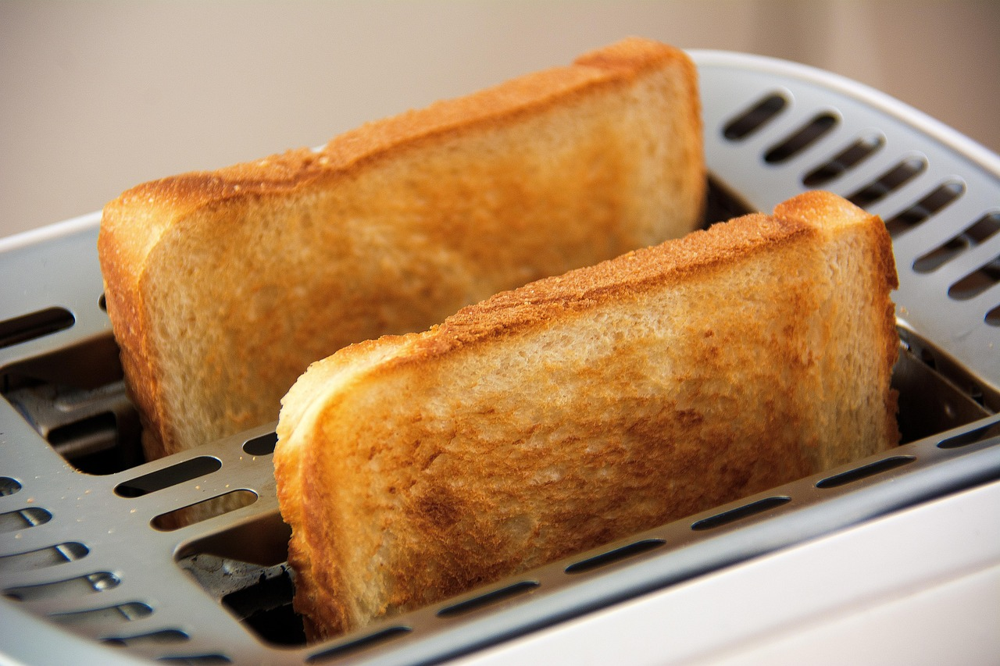
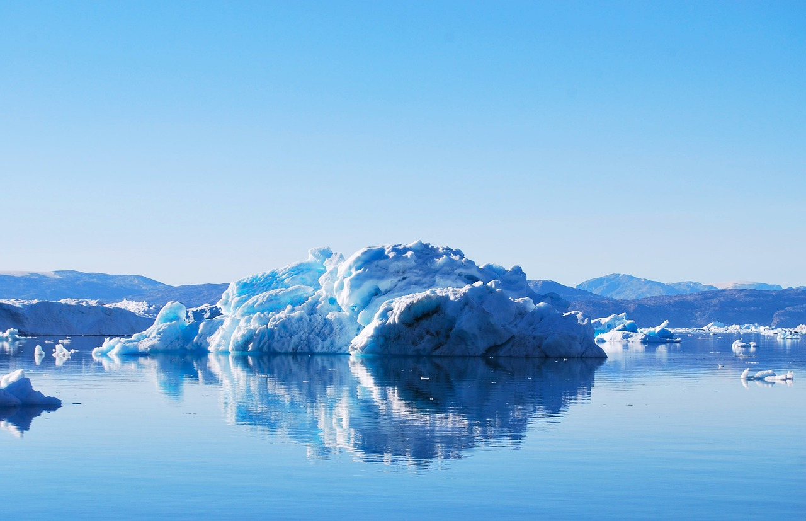

# How We Know — week of 2026-W46

## 🔴 Publishing is halted: the safety switch tripped Fri 13 Nov because a safety check failed — not fixed yet

- Shorts under target 2 weeks running: 3 of 9 published this week, 5 of 9 the week before; shelf 16 (1.8 weeks)
- An episode has no captions and no narration timing to build them from
- Episode calendar has gaps: 10 empty day(s) in the next two weeks, first Mon 16 Nov (deep-sea-ocean-science)
- Episodes under target: 0 of 6 uploaded this week, 2 scheduled ahead

## Is this working? (measured 2026-11-13)

- **28-day views:** 2,740 - long-form 762 · Shorts 1,978 (72% Shorts)
- **Median views per long-form video:** 17 across 40 video(s); per Short 28 across 81
- **Average view duration:** 1m11s (72 s) vs the 146 s floor - BELOW (long-form, trailing 28 days)
- **Subscribers:** +4 in 28 days; 31 of the 500 Expanded YPP needs
- **Watch hours (long-form):** 22.7 of 3,000 (0.8%); 15 h in 28 days, ~784 weeks to the bar at that pace
- **Shorts:** 3 published in 7 days vs 9/week target (5 the week before) - UNDER target; shelf 16 verified unpublished = 1.8 week(s) (0 scheduled on YouTube, 16 on R2 at 2026-11-15 17:07 UTC)
- **Impressions / CTR:** not exposed to this channel by the YouTube Analytics API (HTTP 400: The query is not supported. Check the documentation at https://developers.google)

**6 episode(s) aired** · **6/week** · breaker **TRIPPED** · **16 named stop(s)**

> The circuit breaker is OPEN since 2026-11-13T22:05:54+00:00 — cause `domain`. Publishing is halted until it is reset. 3 consecutive materials-and-manufacturing videos below the duration floor while 1 other domain(s) are holding. That is a NICHE that is not working, not a format that is. Shortening every episode on the channel would be the wrong repair.

## Queued this week

What a lane put on YouTube in the last seven days, dated and waiting to air.

Nothing was queued: nothing new was finished this week. The calendar below says whether that matters yet.

## Pipeline health

| Stage | Count | |
|---|---|---|
| Topics queued, not yet uploaded | 59 | |
| …of which scripted | 34 | |
| …of which narrated | 12 | |
| Finished on the Mac, waiting to upload | 0 |  |
| Uploaded and dated on YouTube | 2 | |
| Mac last reported | Sun 15 Nov 15:00 UTC |  |

## The calendar — next 4 weeks

**22 empty slot(s)**, **10 inside 14 days**. Empty means no episode is dated for a day the cadence publishes on.

| Date | Domain | Episode |
|---|---|---|
| Mon 16 Nov | deep-sea-ocean-science | **— EMPTY —** 🔴 |
| Tue 17 Nov | materials-and-manufacturing | is-damascus-steel-better |
| Wed 18 Nov | money-and-business | does-damascus-steel-rust |
| Thu 19 Nov | deep-sea-ocean-science | **— EMPTY —** 🔴 |
| Fri 20 Nov | materials-and-manufacturing | **— EMPTY —** 🔴 |
| Sat 21 Nov | money-and-business | **— EMPTY —** 🔴 |
| Mon 23 Nov | deep-sea-ocean-science | **— EMPTY —** 🔴 |
| Tue 24 Nov | materials-and-manufacturing | **— EMPTY —** 🔴 |
| Wed 25 Nov | money-and-business | **— EMPTY —** 🔴 |
| Thu 26 Nov | deep-sea-ocean-science | **— EMPTY —** 🔴 |
| Fri 27 Nov | materials-and-manufacturing | **— EMPTY —** 🔴 |
| Sat 28 Nov | money-and-business | **— EMPTY —** 🔴 |
| Mon 30 Nov | deep-sea-ocean-science | **— empty —** 🟡 |
| Tue 01 Dec | materials-and-manufacturing | **— empty —** 🟡 |
| Wed 02 Dec | money-and-business | **— empty —** 🟡 |
| Thu 03 Dec | deep-sea-ocean-science | **— empty —** 🟡 |
| Fri 04 Dec | materials-and-manufacturing | **— empty —** 🟡 |
| Sat 05 Dec | money-and-business | **— empty —** 🟡 |
| Mon 07 Dec | deep-sea-ocean-science | **— empty —** 🟡 |
| Tue 08 Dec | materials-and-manufacturing | **— empty —** 🟡 |
| Wed 09 Dec | money-and-business | **— empty —** 🟡 |
| Thu 10 Dec | deep-sea-ocean-science | **— empty —** 🟡 |
| Fri 11 Dec | materials-and-manufacturing | **— empty —** 🟡 |
| Sat 12 Dec | money-and-business | **— empty —** 🟡 |

## Aired this week

| Date | Episode | Domain |
|---|---|---|
| Sat 14 Nov | [why-are-deep-sea-creatures-so-big](https://youtu.be/VUeFHBIXoRc) | deep-sea-ocean-science |
| Fri 13 Nov | [why-deep-sea-creatures-are-creepers](https://youtu.be/N1mpUttSNd8) | deep-sea-ocean-science |
| Thu 12 Nov | [how-deep-can-whales-dive](https://youtu.be/bjSlVIIDPsE) | deep-sea-ocean-science |
| Wed 11 Nov | [what-lives-in-mariana-trench](https://youtu.be/pT1BETTFbsY) | deep-sea-ocean-science |
| Tue 10 Nov | [what-is-hydrothermal-vents](https://youtu.be/TN0MquikEPM) | deep-sea-ocean-science |
| Mon 09 Nov | [why-deep-sea-fish-die-when-brought-to-surface](https://youtu.be/TEmyz8h_DIA) | deep-sea-ocean-science |

## Runway

| Domain | Slots/wk | Queued | Weeks left | |
|---|---|---|---|---|
| deep-sea-ocean-science | 2 of 2 | 12 | 6.0 | 🟢 |
| food-science | 0 of 0 | 11 | — | ⚪ |
| materials-and-manufacturing | 2 of 2 | 20 | 11.0 | 🟢 |
| money-and-business | 2 of 2 | 12 | 6.0 | 🟢 |

## Lanes, 30-day check

Both long-form nights go to Money for its 12-video test from 10 Nov 2026; each lane is judged at 30 days (10 Dec 2026) on watch hours and subscribers.

| Lane | Long videos in the window | Watch hours | Subscribers | Views | Check |
|---|---|---|---|---|---|
| deep-sea-ocean-science | 5 | not read | not read | not read | 30-day check due 2026-12-10 |
| materials-and-manufacturing | 0 | - | - | - | 30-day check due 2026-12-10 |
| food-science | 0 | - | - | - | 30-day check due 2026-12-10 |
| money-and-business | 0 | - | - | - | 30-day check due 2026-12-10 |

NAMED STOP [LANE_CHECK_NOT_READ] deep-sea-ocean-science: bjSlVIIDPsE - the next Friday measure writes the rows.

## Photos picked automatically

The loop picked these itself rather than wait. Reply with the episode and what you'd like instead, and it is changed.

| Episode | Picture | Source |
|---|---|---|
| how-was-bernie-madoff-caught |  | drawn card |
| why-bread-rises-steak-browns-chocolate-snaps |  | [Pixabay · Pixabay Content License](https://pixabay.com/photos/bread-toaster-food-toast-1077984/) |
| why-did-ftx-collapse |  | drawn card |
| why-greenland-shark-live-so-long |  | [Pixabay · Pixabay Content License](https://pixabay.com/photos/greenland-iceberg-fjord-sermilik-3925547/) |

## Named stops

**1 stop(s) needed a human** and each opened its own issue when it happened:

| Stage | What happened | What it said |
|---|---|---|
| captions-build | an episode has no captions and no narration timing to build them from | 21 queued episode(s) have no caption track and no measured narration timing to build one from: how-powder-meta |

Cleared on their own this week: These Shorts wait for their replacement masters to contain moving footage; the next batch re-cuts them automatically.; another lane also stopped on the safety switch that was already reported; every Short already links to its episode and every video is in its playlist; every first-person line in the queue is already traced to an interview; every live video already has its translated titles, so there was nothing to do; every thumbnail set matches its title; every upcoming episode already has a passing title; food long-forms are paused for the Money test; no new viewer comments this week; the next Money episode waits until the Mac renders the current ones; the runway is fine; topping it up waits for the Money test to finish.

## Monetisation

Nearest gate is **Expanded YPP** — 22.68h of long-form watch time, 31 subscriber(s). 78 days to 2027-02-01, when the long-form bar doubles for channels admitted after it.

---

Nothing here needs a reply. Every number above was decided and applied by the lane that owns it; this is a report, not a request. A decision that needs you opens its own issue.

